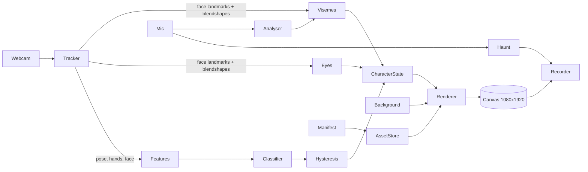

# Design Document

## Overview

Doodle Mirror is a single-page Vite + TypeScript app. One loop reads webcam frames, runs three MediaPipe landmarkers on device, turns landmarks into a small feature vector, classifies it into one of eight drawn poses with hysteresis, picks eye and mouth patches, and draws everything on a 1080x1920 Canvas2D stage over an animated spooky background. The stage can be recorded with mic audio through MediaRecorder.

Guiding rule (see `.kiro/steering/animation.md`): the tracked skeleton only **chooses** a drawing; it never deforms one.

## Architecture



### Frame loop
1. `requestVideoFrameCallback` delivers a frame and its timestamp.
2. `tracker.detect(video, ts)` runs pose + face every frame and hands every 2nd frame; returns a reused `TrackingResult`.
3. `features.compute(result)` → `PoseFeatures` (pure).
4. `classifier.score(features)` → `Record<PoseId, number>` (pure).
5. `hysteresis.update(scores, dtFrames)` → stable `PoseId` (pure, stateful object).
6. `eyes.update(face)` → `'open'|'half'|'closed'`; `visemes.update(blendshapes, micLevel)` → `Viseme`.
7. `renderer.draw(state, now)` draws background, character, face patches, optional debug.
Rendering runs on `requestAnimationFrame`; tracking results are consumed as they arrive so a slow detector never blocks drawing.

## Components and Interfaces

### `assets/manifest.ts`
```ts
type PoseId = 'idle'|'wave'|'point'|'thumbs_up'|'hands_up'|'open_arms'|'facepalm'|'dab';
type SkinId = 'default'|'vampire'|'ghost';
type EyeState = 'open'|'half'|'closed';
type Viseme = 'A'|'E'|'O'|'M'|'smile'|'laugh';
interface Rect { x: number; y: number; w: number; h: number }   // relative to face centre, in ref-face px
interface PoseEntry { file: string; head: { x: number; y: number; size: number }; face: 'full'|'eyes-only'|'mouth-only'|'none' }
interface SkinEntry {
  label: string;
  poses: Record<PoseId, PoseEntry>;
  face: { refSize: number; eyes: Record<EyeState, { file: string; rect: Rect }>; mouths: Record<Viseme, { file: string; rect: Rect }> };
}
interface Manifest { version: 1; canvas: { w: number; h: number; floorY: number }; poseIds: PoseId[]; skins: Record<SkinId, SkinEntry>; background: { file: string; w: number; h: number }; notes?: string }
function loadManifest(url: string): Promise<Manifest>;
function validateManifest(m: unknown): { ok: true; manifest: Manifest } | { ok: false; errors: string[] };
```
Asset paths in the manifest are relative to `assets/`.

### `tracking/tracker.ts`
Creates the three landmarkers from `public/wasm` and `public/models`, GPU then CPU. `detect(video, ts): TrackingResult` with `pose?: Landmark[33]`, `hands: { handedness, landmarks: Landmark[21] }[]`, `face?: { landmarks: Landmark[478]; blendshapes: Map<string, number> }`. Mirrors x (`x = 1 - x`).

### `tracking/features.ts`
Pure. Origin = shoulder midpoint, unit = shoulder width. Outputs for each side (L/R, already mirrored): wrist (x,y), elbow (x,y), wrist-above-head, wrist-above-shoulder, arm extension (shoulder→wrist length), forearm angle, wrist speed in x (for wave, from a 10-frame ring buffer), wrist-in-face-box; from hands: fingers extended mask (thumb..pinky), thumb-up flag, index-only flag, palm-open flag.

### `pose/classifier.ts`
Pure. Hand-tuned scoring functions, one per pose, each returning 0..1 via smoothstep ramps (no ML training needed). Example: `hands_up = min(s(aboveHeadL), s(aboveHeadR))`; `dab = s(armDiagUp(one)) * s(forearmAcrossFace(other))`; `facepalm = s(wristInFaceBox(any))`; `idle = 1 - max(others) * 0.9`, floored at `IDLE_THRESHOLD`. Weights live in `config.ts`.

### `pose/hysteresis.ts`
State: `current`, `candidate`, `candidateFrames`, `heldFrames`, `lostFrames`. Rules from requirement 4. Exposes `update(scores | null): { pose: PoseId; changed: boolean }`.

### `face/eyes.ts`
EAR per eye from FaceLandmarker indices (left: 33,160,158,133,153,144; right: 362,385,387,263,373,380). EMA smoothing, thresholds in config, blendshape fallback, auto-blink scheduler.

### `face/visemes.ts`
Pure mapping from blendshapes (`jawOpen`, `mouthFunnel`, `mouthPucker`, `mouthSmileLeft/Right`, `mouthStretchLeft/Right`, `mouthClose`) to a `Viseme` with a 2-frame minimum hold; mic-RMS fallback cycling M→A→E.

### `render/character.ts`
Holds the active skin's decoded `ImageBitmap`s. Draws the current pose at `(stageCentreX - canvas.w/2 * scale, floorLine - canvas.floorY * scale)` so every pose shares one floor line and scale. Transition modes:
- `cut` (default): 60 ms anticipation squash on the outgoing pose, swap, then incoming pose eases from scale (1.04, 0.96) to (1,1) over 160 ms with `easeOutBack`, pivot at the feet.
- `crossfade` (option): alpha blend ≤120 ms, `easeInOutCubic`.
- `smear` (option): outgoing pose drawn 3× offset along the gesture direction at alpha 0.5/0.3/0.15 for ≤80 ms, then cut.
Then face patches: scale `k = head.size / face.refSize`; for each patch draw at `(head.x + rect.x*k, head.y + rect.y*k, rect.w*k, rect.h*k)` in pose-image coordinates, under the same transform as the pose. Secondary motion (breath, sway) is a transform on the whole drawing.

### `render/background.ts`
Draws the background plate scaled to cover, then procedural layers with a seeded PRNG: 3 parallax fog bands (radial-gradient blobs drifting), 5–8 bats (flapping = 2-frame vector shape, Lissajous paths), candle flicker (warm radial glow with noise-driven radius/alpha at the plate's candle positions from the manifest, optional), moon glow pulse. Honours `prefers-reduced-motion`.

### `audio/mic.ts`, `audio/haunt.ts`
Mic stream on demand. Haunt chain: source → pitch-down (two crossfaded modulated `DelayNode`s, a classic delay-line pitch shifter, ~-4 semitones) → `BiquadFilter` low-pass 2.8 kHz → feedback echo (`DelayNode` 0.28 s, gain 0.35) → destination for recorder. `AnalyserNode` gives RMS for the mouth fallback.

### `record/recorder.ts`
`canvas.captureStream(30)` + audio track → `MediaRecorder` with the first supported mime type; 30 s cap; returns a `Blob` and filename.

### `ui/controls.ts`
Bottom bar: skin chips (from manifest labels), Record (with timer), Haunt toggle, Camera PiP toggle; keyboard shortcuts 1–3, R, H, C, D.

## Data Models

`assets/manifest.json` (written by the asset pipeline; hand-editable):
```json
{
  "version": 1,
  "canvas": { "w": 1024, "h": 1536, "floorY": 1490 },
  "poseIds": ["idle","wave","point","thumbs_up","hands_up","open_arms","facepalm","dab"],
  "skins": {
    "default": {
      "label": "Doodle Swapnil",
      "poses": { "idle": { "file": "skins/default/poses/idle.png", "head": { "x": 512, "y": 300, "size": 210 }, "face": "full" } },
      "face": { "refSize": 512,
        "eyes":   { "open": { "file": "skins/default/face/eyes_open.png", "rect": { "x": -180, "y": -120, "w": 360, "h": 140 } } },
        "mouths": { "A": { "file": "skins/default/face/mouth_A.png", "rect": { "x": -80, "y": 60, "w": 160, "h": 110 } } } }
    }
  },
  "background": { "file": "bg/haunted.png" }
}
```
(Real values are in the committed manifest. All 24 pose PNGs share the 1024x1536 canvas with the feet on `floorY` = 1490 and the same character scale, so poses can be swapped without any per-pose offset. Every face patch has a soft alpha edge and is clipped to the face silhouette; it already contains the surrounding skin, so drawing it over the pose erases the drawn eyes or mouth underneath.)

## Error Handling
- Camera denied / no camera → message + idle character (Req 1.3).
- Model load failure → retry once, then show "Tracking unavailable" and keep idle animation.
- GPU delegate failure → CPU delegate (Req 2.4).
- Manifest invalid → console + debug overlay errors (Req 12.2); skin fallback to default (Req 8.4).
- Mic denied → silent recording with a notice (Req 10.4).
- MediaRecorder unsupported → hide Record and explain.

## Testing Strategy
- **Unit (Vitest):** manifest validator (good manifest passes, each missing field fails with a precise message); features (synthetic landmark fixtures for each pose); classifier (each fixture's top score is the expected pose); hysteresis (noise does not flip; steady input switches after CONFIRM_FRAMES; MIN_HOLD respected; lost-person → idle); eyes (EAR thresholds, smoothing); visemes (each blendshape fixture → expected viseme; 2-frame hold); easing functions (endpoints, monotonic where expected).
- **Fixtures:** `tests/fixtures/poses/*.json`, landmark arrays recorded from the debug overlay ("copy landmarks" button) during development, so tests use real data.
- **Manual QA checklist:** each of the 8 gestures triggers its pose within 0.4 s; no flicker while standing still; blink and talk visible; skin swap; 30 s clip downloads and plays with audio; works on mobile portrait.
- **Hooks:** `.kiro/hooks/lint-and-test.json` runs lint + tests after every spec task; `.kiro/hooks/validate-manifest.json` asks the agent to validate the manifest whenever it changes.
